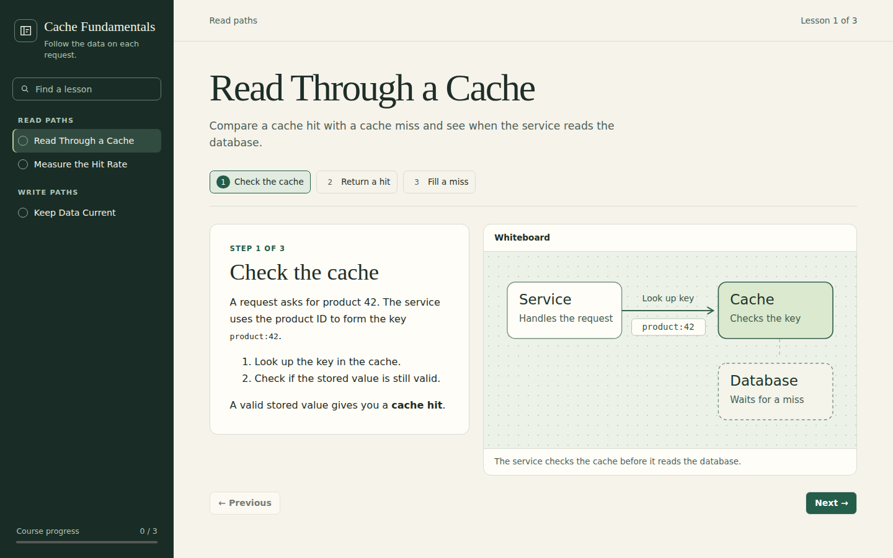

#  Course Board

Build a static course from Markdown. Import a course bundle from the CLI or use Course Board Studio to write lessons and draw whiteboards with Excalidraw. Learners get lesson search, direct step links, keyboard navigation, resizable panes on wide screens, and light and dark themes. Whiteboards can show which example values change from step to step. The browser saves progress and display preferences.

[👀 Preview](#preview) · [🚀 Try the example](#try-the-example) · [📚 Read the guides](#use-course-board-in-a-project)


## Preview

The example course shows lessons, step navigation, and a whiteboard. CI refreshes this screenshot along with the course showcase after the first successful showcase run.



## Courses built with Course Board

These courses use the shared learner shell with their own lessons and diagrams. CI builds both source repositories and refreshes their screenshots after a successful push to `main`. The screenshots appear after the first successful showcase run.

| Course | Site | Source |
| --- | --- | --- |
| DSA Blueprint | [Learn coding interview patterns](https://www.lprakashv.com/dsa-blueprint/) | [Repository](https://github.com/lprakashv/dsa-blueprint) |
| Designed to Scale | [Learn system design](https://www.lprakashv.com/designed-to-scale/) | [Repository](https://github.com/lprakashv/designed-to-scale) |


## Try the example

Install Node.js 20.19 or later and npm. From the Course Board directory, run these commands.

```sh
npm ci
npm run dev
```

Open [the development preview](http://127.0.0.1:4173/). Edit a file in `example/content/` or `example/public/` and reload the page. Press Ctrl+C to stop the server.

In a second terminal, run `npm run author` and open [Course Board Studio](http://127.0.0.1:4175/). Edit the example course, then select **Save course** to write the changes to its source files. To start a separate course, run `node src/cli.js author my-course`. To try the CLI import, run `node src/cli.js ingest example/ingest/course.json my-course`. [Authoring guide](docs/authoring.md).

## Build and check

```sh
npm run lint
npm test
npm run coverage
npm run build
npm run run
```

Open [the production preview](http://127.0.0.1:4174/). The build writes to `example/dist/`. Upload this directory to a static host for the sample site. Coverage reports the modules loaded by Node tests. Use a browser to check the interface.

## Use Course Board in a project

- [Create, write, and customize a course](docs/authoring.md)
- [Use the same build and preview with a custom shell](docs/authoring.md#share-the-build-and-preview)
- [Add stable step links and local code examples](docs/authoring.md#give-a-step-a-stable-link-and-a-code-example)
- [Publish a release artifact, publish to npm, or deploy a site to GitHub Pages](docs/publishing.md)
- [Adopt it in DSA Blueprint and Designed to Scale](docs/migrations.md)
- [Browse the example source](example/content/course.json)
- [Contribute and review changes](CONTRIBUTING.md)

A new course can use the full site builder. An existing interface can use the default shell entry point with a trusted adapter and shared navigation and storage lifecycle. An existing app can import the content compiler or diagram renderer through the package exports. The existing apps can adopt one part at a time.

## Project map

| Path | Purpose |
| --- | --- |
| [`schemas/`](schemas/) | JSON Schema contracts for the manifest and lesson metadata |
| [`src/content.js`](src/content.js) | Markdown compiler and asset validation |
| [`src/author/`](src/author/) | CLI import and local Course Board Studio |
| [`src/browser/`](src/browser/) | Static site and standalone diagram renderer |
| [`example/`](example/) | Sample course and CLI import bundle |
| [`test/`](test/) | Compiler, renderer, navigation, and build tests |
| [`.github/workflows/ci.yml`](.github/workflows/ci.yml) | Build checks and tagged GitHub Releases |
| [`.github/workflows/showcase.yml`](.github/workflows/showcase.yml) | Build the showcase courses and refresh their screenshots |
| [`AGENTS.md`](AGENTS.md) | Contributor and coding agent guidance |

Course Board uses native JavaScript modules so the existing courses can import the renderer without a browser bundler. Markdown-it and YAML match the authoring tools in Designed to Scale. Ajv validates the JSON Schema contracts. Eleventy and Astro content collections can build Markdown sites, but shared course steps and whiteboards would still need course-specific code. [Eleventy](https://www.11ty.dev/) · [Astro content collections](https://docs.astro.build/en/guides/content-collections/)

[MIT License](LICENSE).

Course authors can add structured `data` to chapters, lessons, and steps, or provide a custom build shell. See the [authoring guide](docs/authoring.md#extend-content-and-the-shell).
