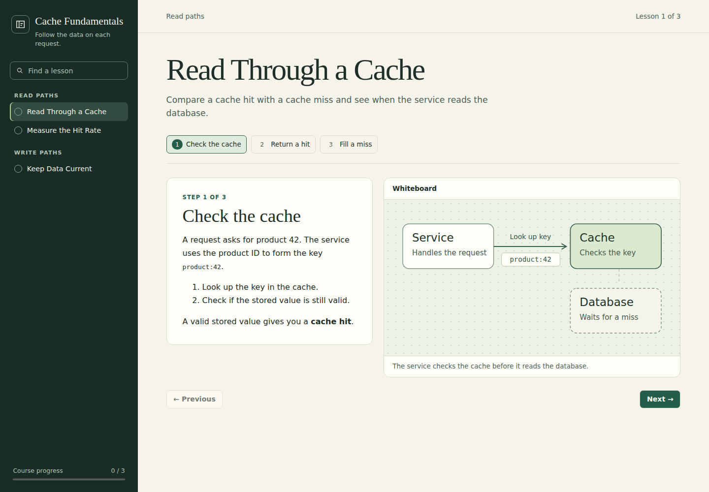
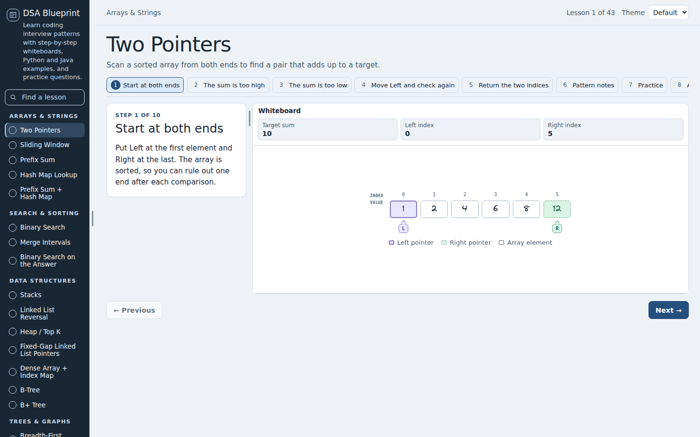
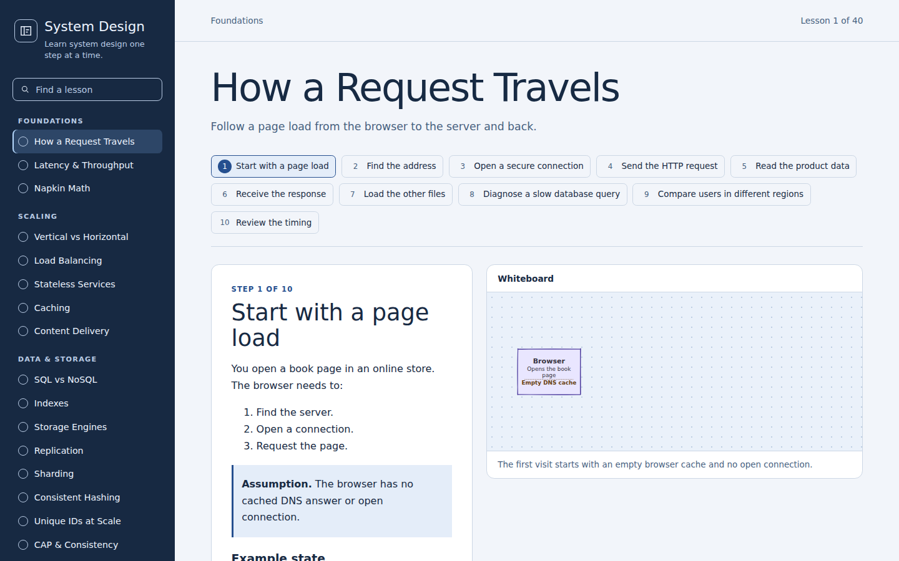

#  Course Board

Build a static course from Markdown. Import a course bundle from the CLI or use Course Board Studio to write lessons and draw whiteboards with Excalidraw. Learners get lesson search, direct step links, keyboard navigation, resizable panes on wide screens, and light and dark themes. Whiteboards can show which example values change from step to step. The browser saves progress and display preferences.

[Preview](#preview) · [Get started](#get-started) · [Features](#features) · [Customization](#customization) · [Guides](#guides)


## Preview

The example course shows lessons, step navigation, and a whiteboard. Select the screenshot to see the latest example build that CI captured.

[](https://raw.githubusercontent.com/lprakashv/course-board/showcase-images/course-board.png)

## Courses built with Course Board

These courses use the shared learner shell with their own lessons and diagrams. CI builds both source repositories and refreshes their screenshots after a successful push to `main`. The screenshots appear after the first successful showcase run.

| Course | Site | Source |
| --- | --- | --- |
| DSA Blueprint | [Learn coding interview patterns](https://www.lprakashv.com/dsa-blueprint/) | [Repository](https://github.com/lprakashv/dsa-blueprint) |
| Designed to Scale | [Learn system design](https://www.lprakashv.com/designed-to-scale/) | [Repository](https://github.com/lprakashv/designed-to-scale) |





## Get started

You need Node.js 20.19 or later and npm. To try the example, clone this repository, open a terminal in its directory, and run:

```sh
npm ci
npm run dev
```

Open [the learner preview](http://127.0.0.1:4173/). Edit a file in `example/content/` or `example/public/`, then reload the page. Press Ctrl+C to stop the server.

To edit the example in Studio, open a second terminal in the repository and run:

```sh
npm run author
```

Open [Course Board Studio](http://127.0.0.1:4175/). Select a lesson, edit a step, and select **Save course**. Reload the learner preview to see the saved changes. See the [Studio guide](docs/studio.md) to create a course or draw a whiteboard.

To create a separate course, follow the [authoring guide](docs/authoring.md). It covers package installation, starter files, CLI import, validation, and publishing.

## Features

| For | Features |
| --- | --- |
| Authors | Markdown lessons with ordered chapters and steps; JSON Schema validation; CLI import; local Studio editor; code snippets and stable step IDs |
| Whiteboards | ASCII, images, SVG, Excalidraw, sandboxed HTML, and custom diagrams; optional captions and example-state changes |
| Learners | Lesson search, step links, previous and next navigation, arrow-key navigation, completion tracking, and a responsive layout |
| Display | Classic, Slate, and Night presets with light blue accents; reader-selected light and dark modes; resizable desktop panes; reduced-motion support |
| Developers | Static builds, local preview, Node compiler and build APIs, browser renderer and shell exports, and GitHub Pages deployment |

Progress and display preferences are stored in the learner's browser. They do not sync across devices.

## Customization

| Goal | Option |
| --- | --- |
| Change colors and fonts | Select a preset or add a CSS theme, including light and dark variants. [Theme guide](docs/authoring.md#6-customize-the-theme-or-add-a-renderer) |
| Add diagrams or navigation behavior | Supply trusted browser extensions with custom diagram renderers or an `onNavigate` hook. [Extension guide](docs/authoring.md#6-customize-the-theme-or-add-a-renderer) |
| Add course-specific fields | Add `data` to chapters, lessons, and steps, and validate it with a course schema. [Data guide](docs/authoring.md#extend-content-and-the-shell) |
| Add optional analytics | Set build environment variables for Google Analytics, Umami, or Plausible. [Publishing guide](docs/publishing.md#add-analytics-to-the-default-site) |
| Change the generated site | Use a build customization callback or provide a full build shell. [Build guide](docs/authoring.md#share-the-build-and-preview) |
| Use an existing interface | Adapt the browser shell, or import the compiler and diagram renderer separately. [Integration guide](docs/authoring.md#import-parts-into-an-existing-app) |

## Build and check

```sh
npm run lint
npm test
npm run coverage
npm run build
npm run run
```

Open [the production preview](http://127.0.0.1:4174/). The build writes to `example/dist/`. Upload this directory to a static host for the sample site. Coverage reports the modules loaded by Node tests. Use a browser to check the interface.

## Guides

- [Create, write, and customize a course](docs/authoring.md)
- [Edit a course and draw whiteboards in Studio](docs/studio.md)
- [Use the same build and preview with a custom shell](docs/authoring.md#share-the-build-and-preview)
- [Add stable step links and local code examples](docs/authoring.md#give-a-step-a-stable-link-and-a-code-example)
- [Publish a release artifact, publish to npm, or deploy a site to GitHub Pages](docs/publishing.md)
- [Adopt it in DSA Blueprint and Designed to Scale](docs/migrations.md)
- [Browse the example source](example/content/course.json)
- [Contribute and review changes](CONTRIBUTING.md)

A new course can use the full site builder. An existing interface can use the default shell entry point with a trusted adapter and shared navigation and storage lifecycle. An existing app can import the content compiler or diagram renderer through the package exports. The existing apps can adopt one part at a time.

## Project map

| Path | Purpose |
| --- | --- |
| [`schemas/`](schemas/) | JSON Schema contracts for the manifest and lesson metadata |
| [`src/content.js`](src/content.js) | Markdown compiler and asset validation |
| [`src/author/`](src/author/) | CLI import and local Course Board Studio |
| [`src/browser/`](src/browser/) | Static site and standalone diagram renderer |
| [`example/`](example/) | Sample course and CLI import bundle |
| [`test/`](test/) | Compiler, renderer, navigation, and build tests |
| [`.github/workflows/ci.yml`](.github/workflows/ci.yml) | Build checks and tagged GitHub Releases |
| [`.github/workflows/showcase.yml`](.github/workflows/showcase.yml) | Build the showcase courses and refresh their screenshots |
| [`AGENTS.md`](AGENTS.md) | Contributor and coding agent guidance |

Course Board uses native JavaScript modules so the existing courses can import the renderer without a browser bundler. Markdown-it and YAML match the authoring tools in Designed to Scale. Ajv validates the JSON Schema contracts. Eleventy and Astro content collections can build Markdown sites, but shared course steps and whiteboards would still need course-specific code. [Eleventy](https://www.11ty.dev/) · [Astro content collections](https://docs.astro.build/en/guides/content-collections/)

[MIT License](LICENSE).
