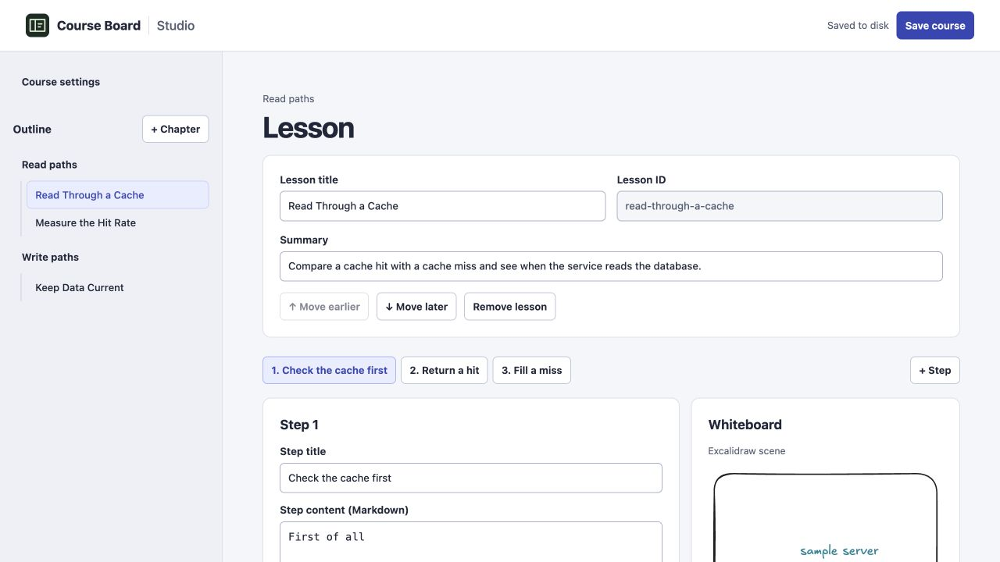

# Edit a course in Studio

Course Board Studio is a local browser editor for a course. Use it to arrange chapters and lessons, write steps, attach diagrams, and draw Excalidraw whiteboards. Studio saves the course source files on your computer. The learner site uses those saved files.



## Start Studio

You need Node.js 20.19 or later, npm, and a Course Board source checkout. Studio needs the checkout's editor dependencies; a package-only installation does not install them.

From the checkout, install dependencies and open the example course:

```sh
npm ci
npm run author
```

Open [Studio](http://127.0.0.1:4175/). To edit a different course, run this command from the checkout instead. Replace the path with your course directory. A directory without a course manifest opens as a new course.

```sh
node src/cli.js author /path/to/my-course
```

To use a different port, set `PORT`, for example `PORT=4176 node src/cli.js author /path/to/my-course`. The server listens on the local loopback address. Press Ctrl+C in the terminal to stop it.

## Create and edit a course

1. Select **Course settings**. Enter a title, a unique course ID, and an optional description. Choose a built-in style or attach a CSS file.
2. Select **+ Chapter**, enter its title, and select **+ Lesson**. Enter the lesson title and summary. Set the lesson ID before the first save; saved lesson IDs are read-only in Studio.
3. Select a step tab to edit its title and Markdown content. Select **+ Step** to add another step. Use `###` or lower for headings in step content.
4. Use **Move earlier** and **Move later** to change the order. You can remove a step, lesson, or chapter. Removing a lesson or chapter removes it from the course outline; its old lesson file stays on disk.
5. Select **Save course**. A new course needs at least one chapter, lesson, and step. Studio validates the course before it writes the files. Correct any error shown and save again.

Keep step order stable after publication if readers use numbered links. For links that follow a step when it moves, add a stable step ID in its source file. See the [content format and stable links](authoring.md#give-a-step-a-stable-link-and-a-code-example).

## Add a whiteboard

Select a lesson and step. In **Whiteboard**, select **Open whiteboard** to draw. To edit an existing Excalidraw scene, select **Import scene** and choose its `.excalidraw` file if the scene is not already loaded. Select **Apply board**, enter alternative text, and select **Save course**. Applying prepares the scene and an SVG export; saving writes both to `public/diagrams/`. The learner site displays the SVG and can offer the scene for download.

You can instead select **Attach diagram** to add an SVG, PNG, JPG, JPEG, GIF, WebP, AVIF, or standalone HTML file. Enter alternative text and an optional caption. HTML boards run in a sandbox with scripts disabled. A step can have one diagram; attaching or applying another replaces its diagram reference. See the [diagram types](authoring.md#5-choose-a-diagram-type) for ASCII and custom diagrams.

## Preview and save

Run the learner preview in a second terminal. For the example, use `npm run dev` in the checkout and open [the preview](http://127.0.0.1:4173/). For another course, run `node src/cli.js dev /path/to/my-course` from the checkout. Reload the preview after you save in Studio. Unsaved Studio changes are not in the preview or production build.

Studio checks for changes made on disk since it opened or last saved. If another editor or import changes the course, Studio rejects a stale save. Preserve any unsaved work, then reload Studio to load the current course. Studio does not provide a merge interface.

Studio writes `content/course.json`, changed lesson files in `content/lessons/`, and attached assets in `public/`. It preserves existing step IDs, snippet references, and structured data. To change those fields, edit the source files and reload Studio. See the [authoring guide](authoring.md) for schemas, snippets, extensions, and custom shells. Files in `public/` are included in the published site.
